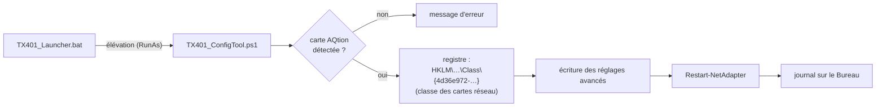

<div align="center">

# 🌐 TX401 Config Tool

**Configure en un double-clic la carte réseau 10 GbE TP-Link TX401 (Marvell AQtion) sous Windows.**


</div>

---

## ✨ Ce que fait l'outil

Après chaque mise à jour du pilote, Windows remet les réglages avancés de la carte à leurs valeurs par défaut. Cet outil les réapplique automatiquement :

| Réglage | Valeur | Pourquoi |
|---|---|---|
| **Energy-Efficient Ethernet** (EEE) | désactivé | évite les micro-coupures et la latence au réveil du lien |
| **Wake on Magic Packet** | activé | allumer le PC à distance (Wake-on-LAN) |
| **Wake on LAN après arrêt** | activé | réveil même depuis un arrêt complet |
| **Tampons réception / émission** | 512 / 2048 | meilleur débit soutenu à 10 Gb/s |

La carte est ensuite redémarrée et un journal est écrit sur le Bureau (`TX401_config_log.txt`).

---

## 🚀 Utilisation

1. Télécharge le dossier `tx401_config_tool/`.
2. Double-clique sur **`TX401_Launcher.bat`** : il relance l'outil PowerShell avec les droits administrateur (confirmation Windows).
3. Une fenêtre confirme les réglages appliqués.

---

## ⚙️ Comment ça marche



L'outil cherche dans le registre la clé du pilote dont la description contient « AQtion » et y écrit les valeurs, exactement comme le ferait l'onglet *Avancé* du Gestionnaire de périphériques.

---

## 🗂️ Organisation des fichiers

```
TX401/
└── tx401_config_tool/
    ├── TX401_Launcher.bat     lanceur : demande les droits administrateur
    └── TX401_ConfigTool.ps1   détection de la carte, réglages, redémarrage, journal
```

---

## 💻 Compatibilité

| | |
|---|---|
| **Système** | Windows 10 et 11 |
| **Carte** | TP-Link TX401 et autres cartes à puce **Marvell AQtion** (AQC107 / AQC113) |
| **Droits** | administrateur (modification du registre des pilotes) |

⚠️ Les noms de réglages dépendent du pilote : sur une version très différente du pilote Marvell, vérifie le résultat dans le Gestionnaire de périphériques.

---

<div align="center"><sub>PowerShell · registre Windows · réseau 10 GbE</sub></div>
